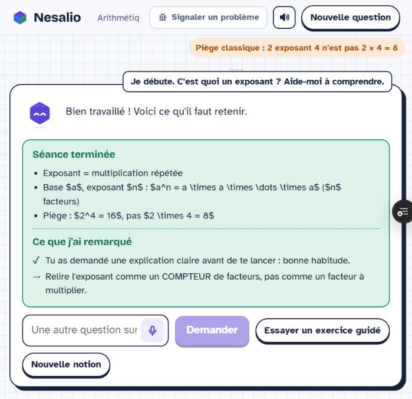
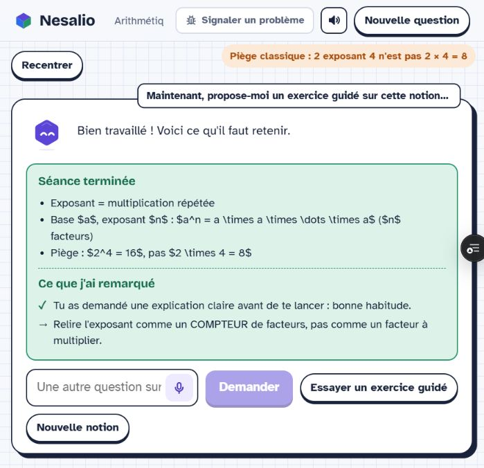
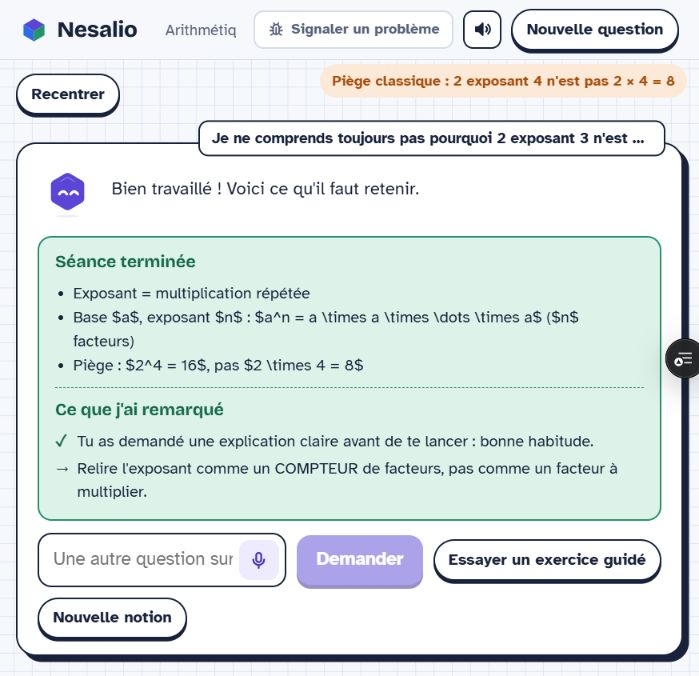

# Revue d'usage du tutorat — 29 octobre 2026

## Méthode

Essai effectué avec le contrôleur du navigateur dans l'application déployée, au clavier, avec le vrai modèle et le parcours visible. Les réponses n'ont pas été simulées ni remplacées par des fixtures. L'agent joue un étudiant débutant, choisit une réponse volontairement fausse puis formule un blocage. Il s'agit d'une revue d'usage scénarisée par un agent, pas d'une étude auprès d'élèves ni d'une mesure de rétention.

La séance de l'utilisateur a été observée sans la modifier ; une autre fenêtre de navigation a servi aux essais. Aucun formulaire de retour, inscription ou contact n'a été envoyé. L'évaluation porte sur l'interaction visible et les contenus lus à l'écran ; elle ne constitue pas une évaluation indépendante de la qualité acoustique.

## Version initiale : d61b084

URL : https://nesalio-7uy6u9s5n-jcod.vercel.app/

| Situation | Action réalisée | Résultat observé | Jugement |
| --- | --- | --- | --- |
| Découverte | « Je débute. C'est quoi un exposant ? Aide-moi à comprendre. » | Nesa explique 2⁴ = 16, puis déroule d'autres exemples. Elle affiche « Séance terminée », sans demander de tentative. | Échec de l'accompagnement proactif. Une explication a été produite, mais la compréhension n'a pas été observée. |
| Erreur | Cliquer sur « Essayer un exercice guidé », puis répondre 20 à « Que vaut 16 × 4 ? » | Le tuteur corrige et représente quatre paquets de 16. Il ne demande pas de nouvel essai. Le bilan affiché reprend celui du premier bloc. | L'aide existe, mais son effet n'est pas vérifié et le bilan n'est pas actualisé. |
| Blocage persistant | « Je ne comprends toujours pas pourquoi 2 exposant 3 n'est pas 2 fois 3. » | L'explication distingue le compteur de facteurs du facteur à multiplier, puis l'interface revient à « Séance terminée », sans activité de vérification. | Le dialogue ne permet pas de savoir si le blocage est levé. |

Autres observations : un point « À travailler » est présenté avant une réponse mathématique de l'élève ; le bilan affiche des délimiteurs et commandes LaTeX bruts ; l'accumulation des exemples rend le tableau petit et peu lisible dans le panneau observé.

## Correction préparée : 60d66e7

Le contrôleur demande une tentative accessible après l'aide, y compris au premier échange et après une erreur. Il refuse une fin prématurée et peut demander une réparation bornée au modèle. Les demandes explicites sans exercices ou d'arrêt restent possibles. Les exemples du prompt suivent la boucle explication utile → tentative → feedback → nouvelle tentative.

Le bilan devient un « Point d'étape », est actualisé après une clarification et ne présente pas de constat individuel avant toute tentative. Les formules du bilan sont converties en texte mathématique lisible. Le compteur de réponses ne borne plus la séance à 50 réponses.

La compilation et les vérifications logicielles servent à contrôler les régressions ; le jugement sur le tutorat doit venir des essais dans le navigateur ci-dessous.

## Nouvel essai dans le navigateur

À compléter après observation de la prévisualisation corrigée. Aucun résultat positif n'est encore attribué à la correction dans ce document intermédiaire.
