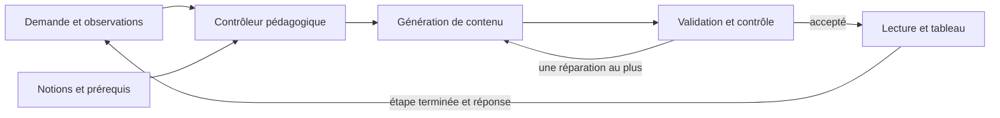

# Enseigner avant d'évaluer

## Problème observé

Les consignes précédentes imposaient une prédiction au premier tour, puis une question à chaque tour. Le lecteur attend la réponse au premier `check`. Un élève qui découvre la notion pouvait ainsi être sollicité avant d'avoir reçu les outils pour répondre.

Un audit de cinq requêtes réelles sur la version fe5a131 a trouvé trois premiers tours débutants terminés par une question après 48, 79 et 86 mots. Cela ne rend pas toutes ces questions inadaptées : le contrôle sur le tiers venait après une définition. En revanche, la découverte des fonctions ne montrait aucun exemple d'entrée-sortie résolu avant de demander la sortie pour 3. La demande explicite sans quiz a été respectée dans cet échantillon.

Un cas sur la dérivée était mathématiquement faux : pour x², P=(1,1) et Q=(q,q²), la pente de PQ vaut q+1 et diminue de 4 vers 2 lorsque q va de 3 vers 1. Le modèle indiquait « verticale » comme bonne réponse et annonçait un déplacement absent des commandes. C'est une erreur de contenu que la validation structurelle ne détecte pas.

La consultation autorisée des enregistrements Vercel a ensuite porté sur les journées UTC des 22, 24, 26 et 27 octobre 2026 : 38 tours, dont 8 essais connus de cet audit/comparatif, écartés des statistiques suivantes. Les 30 autres tours appartiennent à 11 identifiants de navigation ; leur auteur et leur caractère scolaire ou expérimental ne sont pas établis. Les 15 premiers tours se terminent tous par une question après 37 à 107 mots (médiane : 52). Douze des treize continuations posent une nouvelle question, dont les trois continuations après une réponse fausse. Ces fréquences décrivent le comportement, pas la pertinence de chaque question ni l'apprentissage.

Dans la séance « rivière », le point S est bien créé avec une étiquette : son absence ne peut donc pas être affirmée. Le défaut vérifiable est ailleurs : aucun lien entre rivière et longueur cherchée n'est établi ; la construction utilise `within:"tri"` alors que cette figure n'a jamais été créée, et le texte demande SD/DA tandis que le QCM demande SD/SA. Dans l'autre introduction à Thalès, la question emploie B, C, D et E avant de les créer ; le tour suivant enseigne les rapports, puis propose un calcul sans l'avoir entièrement modélisé auparavant. Les données brutes restent dans `analyses/rea-private/`, exclu de Git ; aucun identifiant de navigation ou d'inscription n'est publié.

L'exemple de Thalès signalé par l'utilisateur révèle un autre besoin : expliquer la correspondance entre situation et figure, l'identité des points, les alignements et le parallélisme avant d'écrire les rapports.

## Fondements et traduction dans le produit

- [Rosenshine, Principles of Instruction (2012)](https://www.aft.org/sites/default/files/periodicals/Rosenshine.pdf) décrit l'enseignement par étapes, les modèles, l'étayage et la pratique guidée, ainsi que la vérification de compréhension. Les questions restent utiles : leur intérêt n'autorise pas un rythme automatique identique pour tous.
- [IES, Organizing Instruction and Study to Improve Student Learning (2007)](https://ies.ed.gov/ncee/WWC/Docs/PracticeGuide/20072004.pdf) recommande d'articuler exemples résolus et exercices, d'associer graphique et explication verbale, et de rendre explicites les liens entre représentations concrètes et abstraites. Ici, une rivière ne devient pas un triangle sans expliquer ce qui correspond à quoi et pourquoi la construction est valable.
- [EEF, Cognitive science approaches in the classroom (2021)](https://educationendowmentfoundation.org.uk/education-evidence/evidence-reviews/cognitive-science-approaches-in-the-classroom) rappelle l'importance de la mise en œuvre et du contexte. Ces sources éclairent la conception ; elles ne valident pas les résultats d'apprentissage de Nésalio.
- [AERO, Explicit instruction](https://www.edresearch.edu.au/guides-resources/practice-guides/explicit-instruction-practice-guide-full-publication) propose des tâches graduées, des exemples entièrement expliqués et une réduction progressive de l'aide avec la progression des élèves. Une demande explicite d'explication et une demande d'entraînement n'appellent donc pas automatiquement le même déroulement.
- [AERO, Formative assessment](https://www.edresearch.edu.au/guides-resources/practice-guides/formative-assessment-practice-guide-full-publication) relie les observations à l'ajustement de l'enseignement : recueillir une réponse sans modifier l'aide ne suffit pas. Les vérifications sont utiles au cours de l'apprentissage ; elles ne sont pas supprimées du produit.
- [Koedinger et Corbett, Cognitive Tutors (2006), pp. 137–144](https://pact.cs.cmu.edu/koedinger/pubs/koedingercorbett06.pdf) distinguent le suivi des étapes de résolution et le suivi des connaissances par composante pour sélectionner les activités. Cela motive ici la séparation contenu / observations / décisions. Cette première version n'implémente ni ACT-R, ni model tracing, ni estimation bayésienne de maîtrise ; recopier des paramètres sans données de calibration donnerait une précision fictive.

La traduction suivante est un choix de produit, pas un protocole expérimental validé :

| Situation | Conduite |
| --- | --- |
| Découverte ou niveau inconnu | Sens et but, vocabulaire utile, exemple travaillé avec raisons, puis résumé. Pas de quiz imposé au premier bloc. |
| Débutant déclaré | Plus d'aide et de définitions. Aucun prérequis déclaré acquis sans indice. |
| « Je ne sais pas » | Enseigner et démontrer ; ne pas transformer cette phrase en faute ou en lacune confirmée. |
| Réponse fausse | Émettre une hypothèse prudente, réexpliquer ; nouvelle vérification facultative. |
| Entraînement demandé | Proposer une tâche sur une étape enseignée ; diminuer l'aide progressivement. |
| Exemple corrigé demandé | Montrer la résolution ; ne pas confondre avec une demande de test. |
| Question sur un dessin | Réutiliser les objets et leurs noms ; expliquer les liens avant de changer de représentation. |

## Implémentation

Le moteur est désormais découpé en éléments testables indépendamment de l'IA :

1. `domain/tutor/curriculum.ts` décrit sept notions dans quatre domaines pilotes : fractions, Thalès, sens d'une fonction, pente/dérivée. Chaque notion a des prérequis, une explication attendue et un exemple de référence. Hors de ce catalogue, le tuteur reste disponible sans inventer un graphe de connaissances.
2. `domain/tutor/learning.ts` conserve, par notion, les rôles pédagogiques présentés et les observations de réponse : juste, faux, libre non évaluée ou besoin d'aide, avec le format et l'aide déclarée. Aucun score ou étiquette de maîtrise n'est calculé. Le lecteur enregistre une présentation après la fin de la parole et du dessin de l'étape déclarée finale (`completes:true`) ; une étape reçue mais pas encore jouée, interrompue ou déclarée intermédiaire ne compte pas. Cette mémoire dure la séance de navigation ; elle ne constitue pas encore un dossier longitudinal. Elle est bornée à 16 notions et 8 observations par notion ; la limite de corps de requête passe à 96 000 caractères pour transporter ce contexte.
3. `domain/tutor/controller.ts` décide expliquer/modéliser, pratiquer avec aide ou réexpliquer. Il utilise la demande explicite, la dernière réponse, les prérequis et les présentations observées. Une réponse fausse ou un « je ne sais pas » impose dans cette version un bloc de réexplication sans nouveau `check`. C'est une politique conservatrice choisie pour les défauts observés, pas une loi scientifique interdisant toute question après une erreur.
4. `server/tutor/service.ts` filtre la proposition du modèle **avant** de la transmettre au lecteur. Une question interdite est refusée avec sa phrase et ses dessins, puis un seul appel de réparation continue depuis les étapes déjà envoyées. Un nouveau refus ou une réparation vide produit une erreur explicite, sans faux succès ni boucle d'appels. Si les étapes sont toutes annotées, une couverture déclarée incomplète peut déclencher un complément : explication des prérequis et exemple résolu de la notion visée. Un même problème peut remplir ces rôles, sans exercice supplémentaire pour chaque prérequis. Un exemple résolu déclaré final clôt aussi l'explication de sa notion. Si des annotations manquent, la couverture reste non vérifiable et est signalée dans le journal : le contenu n'est pas répété pour réparer sa seule télémétrie. Une construction `within` visant une figure jamais créée est également refusée. La limite technique passe de 12 à 18 petites étapes pour permettre de finir une résolution.
5. `server/tutor/prompt.ts` fournit le contenu et les contraintes de ce parcours. Les exemples de découverte et d'entraînement sont distingués ; les anciens quotas de questions et de mouvements sont retirés. Le premier appel garde le réglage sans réflexion cachée par défaut : les essais de `low` ont parfois consommé toute la sortie avant de parler. Un réglage explicite reste prioritaire. Si un appel avec réflexion épuise ses jetons avant toute étape, un seul nouvel essai sans réflexion est autorisé ; aucune étape déjà transmise n'est rejouée. Ce repli ne garantit pas la correction du contenu et peut encore coûter un délai important.

L'interface conserve les questions guidées, mais permet « Montre-moi d'abord ». Après une explication, l'élève peut demander un exercice guidé. Les calculs et figures existants restent utilisables.

## Premier parcours dont le contenu est calculé : Thalès

`server/tutor/programs/thales.ts` ajoute un parcours restreint d'introduction à Thalès. Il est servi par le moteur sans génération de texte par un modèle : objectif, construction progressive de S/A/B/D/E, alignements, parallèle, correspondances, rapports, exemple résolu et vérification. Il commence directement par une construction géométrique ; aucune histoire de rivière sans correspondance explicite n'est ajoutée. Les sommets reçoivent aussi des points visibles ; la commande `point` peut désormais viser un sommet nommé avec `at:"S"`, sans coordonnées calculées par l'IA.

Quatre jeux de mesures alimentent à la fois le triangle, le placement de D, la parallèle, les phrases numériques, les choix du QCM et la correction. La résolution est `DE = AB × SD / SA`. Les mesures invalides sont rejetées. Les tests rejouent les commandes dans le moteur réel et vérifient les cinq points, les rapports SD/SA, SE/SB et DE/AB, ainsi que le parallélisme : ils ne se limitent pas à comparer des chaînes JSON.

L'exercice n'apparaît qu'après une demande explicite de pratique. Une erreur ou une demande d'aide reçoit une résolution, sans nouveau test imposé. La correction numérique du parcours est calculée à partir de la réponse et des mesures ; elle ne dépend pas du booléen `correct` envoyé par le navigateur. Une réponse libre non interprétable ne reçoit pas de verdict inventé.

Le navigateur transmet un état de parcours versionné (`thales-v1`, numéro d'exercice, phase). La provenance `curriculum` est distinguée de `model` et `demo` dans le flux et les enregistrements ; aucun modèle n'est attribué à une leçon qui n'en utilise pas. Un besoin d'aide général reconnu reste dans le parcours ; une question précise libre repasse par le modèle et le quitte. Les demandes spécialisées, la réciproque, une preuve, un problème chiffré personnel ou une application à une rivière ne sont pas remplacés par cette introduction standard.

Après deux observations consécutives de difficulté sur les rapports (erreur ou besoin d'aide), le parcours essaie une autre représentation : coefficient d'agrandissement `SA/SD`, puis opération inverse pour retrouver `DE`. Les points et les mesures sont conservés. Ce seuil de deux est une première règle de produit testable, à évaluer ; il n'est pas présenté comme une prescription issue de la recherche ni comme une estimation du niveau de l'élève.

Ce contenu rédigé et ces calculs vérifiés constituent un premier périmètre borné. Ils ne représentent pas encore un vérificateur général de toute explication ni une adaptation calibrée de la difficulté. Les fractions et les dérivées utilisent encore la génération sous contrôle décrite plus haut. Le passage à d'autres notions doit ajouter des relations vérifiables et des critères de réussite, pas seulement recopier un script.

Validation technique : 410 tests unitaires, vérification TypeScript et build de production réussis. Le scénario `node tools/e2e/thales.mjs` a parcouru le vrai serveur sur ordinateur et téléphone : explication sans QCM, exercice demandé, demande d'aide, puis nouvelle difficulté déclenchant le coefficient d'agrandissement avec les mêmes mesures. La voix était coupée et l'horloge d'affichage accélérée ; ce test ne mesure ni le débit vocal réel ni l'efficacité d'apprentissage. Les captures ont aussi montré que le bilan peut laisser des formules petites sur téléphone : la lisibilité du cadrage reste un chantier distinct.

## Limites et validation

Le détecteur d'intention reste lexical : il ne comprend pas toutes les paraphrases. Le contrôleur garantit les contraintes structurelles décrites ci-dessus, pas la pertinence de toute phrase interrogative ni la qualité d'un exemple. Les annotations `teaching` sont déclarées par le modèle ; les avoir lues prouve uniquement leur présentation, sans certifier qu'elles enseignent correctement. Il n'existe pas encore de vérificateur sémantique général des calculs, des QCM, des hypothèses de Thalès ou des correspondances d'un dessin. Le garde-fou `within` ne valide pas toutes les références géométriques. Ne pas annoncer ces problèmes comme résolus.

Les tests unitaires couvrent les décisions de parcours et les régressions du contrat. Des essais avec le vrai modèle doivent aussi vérifier : premier exemple complet, absence de question prématurée, « je ne sais pas » répété, correction des calculs et cohérence de chaque objet nommé. La fluidité, le cadrage et les collisions demandent une vérification visuelle distincte. Aucune efficacité d'apprentissage n'est déduite du nombre de mots ou de questions.

## Suite du modèle pédagogique

Pour dépasser ce pilote : faire valider les progressions et erreurs typiques par des enseignants ; ajouter des tâches à correction déterministe et suivre les étapes de résolution ; distinguer pratique proche, transfert et rappel différé ; évaluer quand alléger l'aide à partir de preuves répétées sur des tâches différentes. La rétention espacée et le suivi entre séances nécessitent un stockage longitudinal et un choix explicite de produit, absents ici.

Les mesures d'évaluation doivent séparer : conformité du parcours, exactitude mathématique, cohérence des représentations, autonomie sur un problème nouveau et rétention après délai. Comparer les versions sur des scénarios identiques avec revue humaine, puis sur des apprentissages mesurés ; ne pas assimiler satisfaction ou longueur d'explication à un gain de compréhension.
