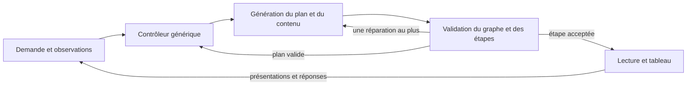

# Enseigner avant d'évaluer

## Problème observé

Les consignes précédentes imposaient une prédiction au premier tour, puis une question à chaque tour. Le lecteur attend la réponse au premier `check`. Un élève qui découvre la notion pouvait ainsi être sollicité avant d'avoir reçu les outils pour répondre.

Un audit de cinq requêtes réelles sur la version fe5a131 a trouvé trois premiers tours débutants terminés par une question après 48, 79 et 86 mots. Cela ne rend pas toutes ces questions inadaptées : le contrôle sur le tiers venait après une définition. En revanche, la découverte des fonctions ne montrait aucun exemple d'entrée-sortie résolu avant de demander la sortie pour 3. La demande explicite sans quiz a été respectée dans cet échantillon.

Un cas sur la dérivée était mathématiquement faux : pour x², P=(1,1) et Q=(q,q²), la pente de PQ vaut q+1 et diminue de 4 vers 2 lorsque q va de 3 vers 1. Le modèle indiquait « verticale » comme bonne réponse et annonçait un déplacement absent des commandes. C'est une erreur de contenu que la validation structurelle ne détecte pas.

La consultation autorisée des enregistrements Vercel a ensuite porté sur les journées UTC des 22, 24, 26 et 27 octobre 2026 : 38 tours, dont 8 essais connus de cet audit/comparatif, écartés des statistiques suivantes. Les 30 autres tours appartiennent à 11 identifiants de navigation ; leur auteur et leur caractère scolaire ou expérimental ne sont pas établis. Les 15 premiers tours se terminent tous par une question après 37 à 107 mots (médiane : 52). Douze des treize continuations posent une nouvelle question, dont les trois continuations après une réponse fausse. Ces fréquences décrivent le comportement, pas la pertinence de chaque question ni l'apprentissage.

Dans la séance « rivière », le point S est bien créé avec une étiquette : son absence ne peut donc pas être affirmée. Le défaut vérifiable est ailleurs : aucun lien entre rivière et longueur cherchée n'est établi ; la construction utilise `within:"tri"` alors que cette figure n'a jamais été créée, et le texte demande SD/DA tandis que le QCM demande SD/SA. Dans l'autre introduction à Thalès, la question emploie B, C, D et E avant de les créer ; le tour suivant enseigne les rapports, puis propose un calcul sans l'avoir entièrement modélisé auparavant. Les données brutes restent dans `analyses/rea-private/`, exclu de Git ; aucun identifiant de navigation ou d'inscription n'est publié.

L'exemple de Thalès signalé par l'utilisateur révèle un autre besoin : expliquer la correspondance entre situation et figure, l'identité des points, les alignements et le parallélisme avant d'écrire les rapports.

## Fondements et traduction dans le produit

- [Rosenshine, Principles of Instruction (2012)](https://www.aft.org/sites/default/files/periodicals/Rosenshine.pdf) décrit l'enseignement par étapes, les modèles, l'étayage et la pratique guidée, ainsi que la vérification de compréhension. Les questions restent utiles : leur intérêt n'autorise pas un rythme automatique identique pour tous.
- [IES, Organizing Instruction and Study to Improve Student Learning (2007)](https://ies.ed.gov/ncee/WWC/Docs/PracticeGuide/20072004.pdf) recommande d'articuler exemples résolus et exercices, d'associer graphique et explication verbale, et de rendre explicites les liens entre représentations concrètes et abstraites. Ici, une rivière ne devient pas un triangle sans expliquer ce qui correspond à quoi et pourquoi la construction est valable.
- [EEF, Cognitive science approaches in the classroom (2021)](https://educationendowmentfoundation.org.uk/education-evidence/evidence-reviews/cognitive-science-approaches-in-the-classroom) rappelle l'importance de la mise en œuvre et du contexte. Ces sources éclairent la conception ; elles ne valident pas les résultats d'apprentissage de Nésalio.
- [AERO, Explicit instruction](https://www.edresearch.edu.au/guides-resources/practice-guides/explicit-instruction-practice-guide-full-publication) propose des tâches graduées, des exemples entièrement expliqués et une réduction progressive de l'aide avec la progression des élèves. Une demande explicite d'explication et une demande d'entraînement n'appellent donc pas automatiquement le même déroulement.
- [AERO, Formative assessment](https://www.edresearch.edu.au/guides-resources/practice-guides/formative-assessment-practice-guide-full-publication) relie les observations à l'ajustement de l'enseignement : recueillir une réponse sans modifier l'aide ne suffit pas. Les vérifications sont utiles au cours de l'apprentissage ; elles ne sont pas supprimées du produit.
- [Koedinger et Corbett, Cognitive Tutors (2006), pp. 137–144](https://pact.cs.cmu.edu/koedinger/pubs/koedingercorbett06.pdf) distinguent le suivi des étapes de résolution et le suivi des connaissances par composante pour sélectionner les activités. Cela motive ici la séparation contenu / observations / décisions. Cette première version n'implémente ni ACT-R, ni model tracing, ni estimation bayésienne de maîtrise ; recopier des paramètres sans données de calibration donnerait une précision fictive.

La traduction suivante est un choix de produit, pas un protocole expérimental validé :

| Situation | Conduite |
| --- | --- |
| Découverte ou niveau inconnu | Sens et but, vocabulaire utile, exemple travaillé avec raisons, puis résumé. Pas de quiz imposé au premier bloc. |
| Débutant déclaré | Plus d'aide et de définitions. Aucun prérequis déclaré acquis sans indice. |
| « Je ne sais pas » | Enseigner et démontrer ; ne pas transformer cette phrase en faute ou en lacune confirmée. |
| Réponse fausse | Émettre une hypothèse prudente, réexpliquer ; nouvelle vérification facultative. |
| Entraînement demandé | Proposer une tâche sur une étape enseignée ; diminuer l'aide progressivement. |
| Exemple corrigé demandé | Montrer la résolution ; ne pas confondre avec une demande de test. |
| Question sur un dessin | Réutiliser les objets et leurs noms ; expliquer les liens avant de changer de représentation. |

## Implémentation générique

Le moteur sépare le contenu proposé par l'IA, les observations et les décisions exécutées par le logiciel. Il ne sélectionne plus de leçon à partir d'un nom de notion. Le module `programs/thales.ts`, son état de parcours et le catalogue fixe `curriculum.ts` sont supprimés.

1. `domain/tutor/plan.ts` définit un plan construit pour chaque demande : objectif, notions identifiées librement et prérequis. Le logiciel refuse les identifiants dupliqués, cibles absentes, dépendances absentes et cycles. Il ordonne uniquement les dépendances de l'objectif courant. Cette validation porte sur la structure ; elle ne certifie pas la pertinence scientifique des prérequis proposés par l'IA.
2. `domain/tutor/learning.ts` conserve les présentations terminées et les réponses observées, avec leur format et leur aide. Une étape reçue ou interrompue ne compte pas comme présentée. Une demande d'aide sans notion identifiée reste non attribuée, sans inventer de lacune. La mémoire de navigation contient au plus 16 notions, 8 observations par notion et 12 observations récentes. Aucun score de maîtrise n'est déduit d'un QCM réussi. La limite du corps de requête est de 96 000 caractères.
3. `domain/tutor/controller.ts` choisit expliquer/modéliser, pratiquer avec aide ou réexpliquer. La découverte reçoit un exemple travaillé ; la première difficulté appelle une décomposition ; deux difficultés consécutives observées sur l'objectif, ou non attribuées, appellent une autre représentation. Les observations attribuées à une autre notion ne gonflent pas ce compteur. Ce seuil est une règle de produit testable, pas une prescription scientifique ni un niveau calculé. Le même code s'applique à un identifiant jamais rencontré auparavant.
4. `server/tutor/service.ts` contrôle les étapes avant de transmettre leurs paroles et dessins. Une question prématurée ou une construction dans une figure absente déclenche au plus une réparation, depuis les étapes déjà envoyées. Un nouveau refus ou une réparation vide produit une erreur explicite. Un nouveau plan valide met à jour les décisions pendant le flux sans autoriser un quiz refusé par l'élève. Quand toutes les étapes sont annotées, une couverture déclarée incomplète peut demander la fin d'un exemple ou d'un prérequis ; des annotations manquantes ne prouvent pas qu'une explication manque. La limite est de 18 étapes par tour.
5. `server/tutor/prompt.ts` donne à l'IA le plan courant, les observations et la stratégie choisie, pour produire l'explication adaptée. Il demande de relier les représentations et d'expliciter les conditions d'application d'une règle. Les quotas de questions et de mouvements sont retirés. Le premier appel garde par défaut le réglage sans réflexion cachée ; un réglage explicite reste prioritaire. Un épuisement de jetons avant toute étape permet un seul nouvel essai sans réflexion, sans rejouer du contenu déjà présenté.

L'interface propose « Montre-moi d'abord » et, après une explication, « Essayer un exercice guidé ». Le plan et les observations sont transportés entre les tours et conservés dans les enregistrements pour analyser les décisions. La commande générique `point` peut viser un sommet nommé, par exemple `at:"S"`, sans recalculer sa position. Les primitives de dessin restent réutilisables ; elles ne contiennent pas de progression pédagogique propre à un théorème.

## Limites et validation

Ce système adapte la conduite de la séance ; il n'apprend pas encore automatiquement de ses échecs entre plusieurs séances. Le qualifier d'antifragile serait prématuré. Il faut mesurer les erreurs, examiner les traces, améliorer les règles et vérifier les régressions pour démontrer une amélioration durable.

Le détecteur d'intention reste lexical. Le graphe, les annotations pédagogiques, les explications et les réponses attendues sont proposés par le modèle : une structure valide et une présentation terminée ne certifient ni leur exactitude ni la compréhension de l'élève. Le garde-fou `within` ne valide pas toutes les références géométriques. Il n'existe pas encore de vérificateur sémantique général des calculs, des QCM et des correspondances d'un dessin. L'absence d'un plan ou d'annotations reste compatible avec les anciens clients ; elle réduit les contrôles de couverture disponibles.

Les tests couvrent les graphes incohérents, des identifiants arbitraires, l'adaptation après difficultés répétées, les préférences sans quiz, les réparations bornées, la mémoire et sa transmission. Le scénario navigateur `tools/e2e/pedagogie.mjs` vérifie les échanges interface/mémoire sur ordinateur et téléphone avec des réponses simulées : il ne mesure pas la qualité du vrai modèle. Les essais avec le vrai modèle doivent vérifier la pertinence des explications, l'exactitude, les noms des objets et les transitions entre représentations. Le cadrage et la lisibilité demandent une vérification visuelle distincte.

## Suite du modèle pédagogique

Faire valider les stratégies par des enseignants ; ajouter des validations réutilisables de relations et de calculs, sans scénario par notion ; distinguer exercice proche, transfert et rappel différé ; évaluer quand alléger l'aide à partir de preuves répétées sur des tâches différentes. Un suivi entre séances et une rétention espacée nécessitent un stockage longitudinal et un choix de produit, absents ici.

Les mesures doivent séparer conformité du parcours, exactitude, cohérence des représentations, autonomie sur un problème nouveau et rétention après délai. Comparer les versions sur des scénarios identiques avec revue humaine, puis sur des apprentissages mesurés ; ne pas assimiler satisfaction ou longueur d'explication à un gain de compréhension.