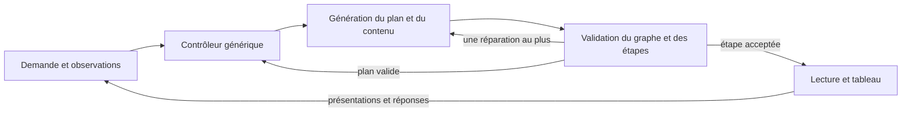

# Enseigner avant d'évaluer

> Les règles initiales ci-dessous décrivent l'historique de la conception. La section « Correction après essai d'usage » fait foi pour le parcours actuel : un tutorat comporte des tentatives et du feedback, pas une explication suivie automatiquement d'une fin.

## Problème observé

Les consignes précédentes imposaient une prédiction au premier tour, puis une question à chaque tour. Le lecteur attend la réponse au premier `check`. Un élève qui découvre la notion pouvait ainsi être sollicité avant d'avoir reçu les outils pour répondre.

Un audit de cinq requêtes réelles sur la version fe5a131 a trouvé trois premiers tours débutants terminés par une question après 48, 79 et 86 mots. Cela ne rend pas toutes ces questions inadaptées : le contrôle sur le tiers venait après une définition. En revanche, la découverte des fonctions ne montrait aucun exemple d'entrée-sortie résolu avant de demander la sortie pour 3. La demande explicite sans quiz a été respectée dans cet échantillon.

Un cas sur la dérivée était mathématiquement faux : pour x², P=(1,1) et Q=(q,q²), la pente de PQ vaut q+1 et diminue de 4 vers 2 lorsque q va de 3 vers 1. Le modèle indiquait « verticale » comme bonne réponse et annonçait un déplacement absent des commandes. C'est une erreur de contenu que la validation structurelle ne détecte pas.

La consultation autorisée des enregistrements Vercel a ensuite porté sur les journées UTC des 22, 24, 26 et 27 octobre 2026 : 38 tours, dont 8 essais connus de cet audit/comparatif, écartés des statistiques suivantes. Les 30 autres tours appartiennent à 11 identifiants de navigation ; leur auteur et leur caractère scolaire ou expérimental ne sont pas établis. Les 15 premiers tours se terminent tous par une question après 37 à 107 mots (médiane : 52). Douze des treize continuations posent une nouvelle question, dont les trois continuations après une réponse fausse. Ces fréquences décrivent le comportement, pas la pertinence de chaque question ni l'apprentissage.

Dans la séance « rivière », le point S est bien créé avec une étiquette : son absence ne peut donc pas être affirmée. Le défaut vérifiable est ailleurs : aucun lien entre rivière et longueur cherchée n'est établi ; la construction utilise `within:"tri"` alors que cette figure n'a jamais été créée, et le texte demande SD/DA tandis que le QCM demande SD/SA. Dans l'autre introduction à Thalès, la question emploie B, C, D et E avant de les créer ; le tour suivant enseigne les rapports, puis propose un calcul sans l'avoir entièrement modélisé auparavant. Les données brutes restent dans `analyses/rea-private/`, exclu de Git ; aucun identifiant de navigation ou d'inscription n'est publié.

L'exemple de Thalès signalé par l'utilisateur révèle un autre besoin : expliquer la correspondance entre situation et figure, l'identité des points, les alignements et le parallélisme avant d'écrire les rapports.

## Fondements et traduction dans le produit

- [Rosenshine, Principles of Instruction (2012)](https://www.aft.org/sites/default/files/periodicals/Rosenshine.pdf) décrit l'enseignement par étapes, les modèles, l'étayage et la pratique guidée, ainsi que la vérification de compréhension. Les questions restent utiles : leur intérêt n'autorise pas un rythme automatique identique pour tous.
- [IES, Organizing Instruction and Study to Improve Student Learning (2007)](https://ies.ed.gov/ncee/WWC/Docs/PracticeGuide/20072004.pdf) recommande d'articuler exemples résolus et exercices, d'associer graphique et explication verbale, et de rendre explicites les liens entre représentations concrètes et abstraites. Ici, une rivière ne devient pas un triangle sans expliquer ce qui correspond à quoi et pourquoi la construction est valable.
- [EEF, Cognitive science approaches in the classroom (2021)](https://educationendowmentfoundation.org.uk/education-evidence/evidence-reviews/cognitive-science-approaches-in-the-classroom) rappelle l'importance de la mise en œuvre et du contexte. Ces sources éclairent la conception ; elles ne valident pas les résultats d'apprentissage de Nésalio.
- [AERO, Explicit instruction](https://www.edresearch.edu.au/guides-resources/practice-guides/explicit-instruction-practice-guide-full-publication) propose des tâches graduées, des exemples entièrement expliqués et une réduction progressive de l'aide avec la progression des élèves. Une demande explicite d'explication et une demande d'entraînement n'appellent donc pas automatiquement le même déroulement.
- [AERO, Formative assessment](https://www.edresearch.edu.au/guides-resources/practice-guides/formative-assessment-practice-guide-full-publication) relie les observations à l'ajustement de l'enseignement : recueillir une réponse sans modifier l'aide ne suffit pas. Les vérifications sont utiles au cours de l'apprentissage ; elles ne sont pas supprimées du produit.
- [Koedinger et Corbett, Cognitive Tutors (2006), pp. 137–144](https://pact.cs.cmu.edu/koedinger/pubs/koedingercorbett06.pdf) distinguent le suivi des étapes de résolution et le suivi des connaissances par composante pour sélectionner les activités. Cela motive ici la séparation contenu / observations / décisions. Cette première version n'implémente ni ACT-R, ni model tracing, ni estimation bayésienne de maîtrise ; recopier des paramètres sans données de calibration donnerait une précision fictive.

La traduction suivante est un choix de produit, pas un protocole expérimental validé :

| Situation | Conduite |
| --- | --- |
| Découverte ou niveau inconnu | Sens et but, vocabulaire utile, exemple travaillé avec raisons, puis résumé. Pas de quiz imposé au premier bloc. |
| Débutant déclaré | Plus d'aide et de définitions. Aucun prérequis déclaré acquis sans indice. |
| « Je ne sais pas » | Enseigner et démontrer ; ne pas transformer cette phrase en faute ou en lacune confirmée. |
| Réponse fausse | Émettre une hypothèse prudente, réexpliquer ; nouvelle vérification facultative. |
| Entraînement demandé | Proposer une tâche sur une étape enseignée ; diminuer l'aide progressivement. |
| Exemple corrigé demandé | Montrer la résolution ; ne pas confondre avec une demande de test. |
| Question sur un dessin | Réutiliser les objets et leurs noms ; expliquer les liens avant de changer de représentation. |

## Implémentation générique

Le moteur sépare le contenu proposé par l'IA, les observations et les décisions exécutées par le logiciel. Il ne sélectionne plus de leçon à partir d'un nom de notion. Le module `programs/thales.ts`, son état de parcours et le catalogue fixe `curriculum.ts` sont supprimés.

1. `domain/tutor/plan.ts` définit un plan construit pour chaque demande : objectif, notions identifiées librement et prérequis. Le logiciel refuse les identifiants dupliqués, cibles absentes, dépendances absentes et cycles. Il ordonne uniquement les dépendances de l'objectif courant. Cette validation porte sur la structure ; elle ne certifie pas la pertinence scientifique des prérequis proposés par l'IA.
2. `domain/tutor/learning.ts` conserve les présentations terminées et les réponses observées, avec leur format et leur aide. Une étape reçue ou interrompue ne compte pas comme présentée. Une demande d'aide sans notion identifiée reste non attribuée, sans inventer de lacune. La mémoire de navigation contient au plus 16 notions, 8 observations par notion et 12 observations récentes. Aucun score de maîtrise n'est déduit d'un QCM réussi. La limite du corps de requête est de 96 000 octets UTF-8, vérifiée pendant la lecture.
3. `domain/tutor/controller.ts` choisit expliquer/modéliser, pratiquer avec aide ou réexpliquer. La découverte reçoit un exemple travaillé ; la première difficulté appelle une décomposition ; deux difficultés consécutives observées sur l'objectif, ou non attribuées, appellent une autre représentation. Les observations attribuées à une autre notion ne gonflent pas ce compteur. Ce seuil est une règle de produit testable, pas une prescription scientifique ni un niveau calculé. Le même code s'applique à un identifiant jamais rencontré auparavant.
4. `server/tutor/service.ts` contrôle les étapes avant de transmettre leurs paroles et dessins. Une question prématurée ou une construction dans une figure absente déclenche au plus une réparation, depuis les étapes déjà envoyées. Un nouveau refus ou une réparation vide produit une erreur explicite. Un nouveau plan valide met à jour les décisions pendant le flux sans autoriser un quiz refusé par l'élève. Quand toutes les étapes sont annotées, un exemple cible non terminé peut demander un complément. Les prérequis peuvent être enseignés dans ce même exemple : leur annotation non clôturée ne déclenche pas une leçon supplémentaire par nœud. Des annotations manquantes ne prouvent pas qu'une explication manque. La limite est de 18 étapes par tour.
5. `server/tutor/prompt.ts` donne à l'IA le plan courant, les observations et la stratégie choisie, pour produire l'explication adaptée. Il demande de relier les représentations et d'expliciter les conditions d'application d'une règle. Les quotas de questions et de mouvements sont retirés. Le premier appel garde par défaut le réglage sans réflexion cachée ; un réglage explicite reste prioritaire. Un épuisement de jetons avant toute étape permet un seul nouvel essai sans réflexion, sans rejouer du contenu déjà présenté.



L'interface propose « Montre-moi d'abord » et, après une explication, « Essayer un exercice guidé ». Le plan et les observations sont transportés entre les tours et conservés dans les enregistrements pour analyser les décisions. La commande générique `point` peut viser un sommet nommé, par exemple `at:"S"`, sans recalculer sa position. Les primitives de dessin restent réutilisables ; elles ne contiennent pas de progression pédagogique propre à un théorème.

## Limites et validation

Ce système adapte la conduite de la séance ; il n'apprend pas encore automatiquement de ses échecs entre plusieurs séances. Le qualifier d'antifragile serait prématuré. Il faut mesurer les erreurs, examiner les traces, améliorer les règles et vérifier les régressions pour démontrer une amélioration durable.

Le détecteur d'intention reste lexical. Le graphe, les annotations pédagogiques, les explications et les réponses attendues sont proposés par le modèle : une structure valide et une présentation terminée ne certifient ni leur exactitude ni la compréhension de l'élève. Le garde-fou `within` ne valide pas toutes les références géométriques. Il n'existe pas encore de vérificateur sémantique général des calculs, des QCM et des correspondances d'un dessin. L'absence d'un plan ou d'annotations reste compatible avec les anciens clients ; elle réduit les contrôles de couverture disponibles.

Les tests couvrent les graphes incohérents, des identifiants arbitraires, l'adaptation après difficultés répétées, les préférences sans quiz, les réparations bornées, la mémoire et sa transmission. Le scénario navigateur `tools/e2e/pedagogie.mjs` vérifie les échanges interface/mémoire sur ordinateur et téléphone avec des réponses simulées : il ne mesure pas la qualité du vrai modèle. Les essais avec le vrai modèle doivent vérifier la pertinence des explications, l'exactitude, les noms des objets et les transitions entre représentations. Le cadrage et la lisibilité demandent une vérification visuelle distincte.

## Suite du modèle pédagogique

Faire valider les stratégies par des enseignants ; ajouter des validations réutilisables de relations et de calculs, sans scénario par notion ; distinguer exercice proche, transfert et rappel différé ; évaluer quand alléger l'aide à partir de preuves répétées sur des tâches différentes. Un suivi entre séances et une rétention espacée nécessitent un stockage longitudinal et un choix de produit, absents ici.

Les mesures doivent séparer conformité du parcours, exactitude, cohérence des représentations, autonomie sur un problème nouveau et rétention après délai. Comparer les versions sur des scénarios identiques avec revue humaine, puis sur des apprentissages mesurés ; ne pas assimiler satisfaction ou longueur d'explication à un gain de compréhension.

## Progression et vérification intégrées — 29 octobre 2026

Le contrôleur existant est étendu sans nouveau fournisseur, dépendance, agent, migration ou service. Les nouveaux champs restent facultatifs pour les démos et les clients existants.

### Frontières des modules

- `domain/tutor/assessment.ts` porte le contrat arithmétique et la correction des réponses. Il réutilise le parseur d'expressions existant, sans `eval`. L'évaluation est faite en fractions exactes, avec longueur, précision des littéraux, taille des entiers et exposants bornés. Le contrat refuse les variables, unités, fonctions, valeurs non définies et approximations. Il vérifie une opération déclarée, **pas** la traduction de l'énoncé, le dessin ou une loi physique.
- `domain/tutor/progress.ts` résume les observations et propose le type de prochaine activité. C'est une fonction de domaine sans réseau, stockage, React ni horloge globale ; l'appelant fournit la date. Elle ne produit ni score de maîtrise ni certification.
- `controller.ts` combine ces indices avec la demande de l'élève, puis contrôle les étapes avant transmission. `service.ts` transmet la même décision au constructeur de messages et conserve une seule réparation par contrôle de tour.
- `engine/player.ts` enregistre la provenance du verdict, l'activité, le type de pratique et la date après la réponse. L'horloge civile des observations est distincte de celle des animations. Une clarification pendant un exercice autonome marque sa réussite comme assistée, même après la reprise de l'exercice.

### Décisions de progression

Deux réussites guidées sur des tâches textuellement distinctes peuvent conduire à proposer une nouvelle tâche autonome. Deux réussites autonomes peuvent conduire à proposer un changement de contexte ou de représentation. Une difficulté récente remet le guidage au premier plan. Une demande explicite d'exercice guidé ou de séance sans quiz reste prioritaire.

Ces seuils (`PRACTICE_SUCCESSES`) sont des règles de produit à évaluer. Un QCM correct reste une observation limitée. Une ancienne observation sans provenance n'entre pas dans ce calcul, sans empêcher de continuer la séance. Le même texte normalisé ou le même `activityId` ne compte pas deux fois ; cette déduplication ne reconnaît pas l'équivalence sémantique de deux exercices.

Après des réussites autonomes datées, `reviewAt` propose une échéance initiale de 24 heures (`REVIEW_DELAY_MS`). L'échéance peut conduire à une activité `retrieval` lors d'une pratique ultérieure si la mémoire est encore disponible. Une annotation `retrieval` immédiate ne devient pas une preuve de rétention : il faut constater le délai dans les observations. Ce n'est ni un rappel envoyé à l'utilisateur ni un planificateur persistant entre visites.

### Contrat d'une activité

```json
{
  "kind": "step",
  "say": "À toi de calculer cette somme.",
  "do": [],
  "teaching": {
    "concept": "addition-fractions",
    "role": "independent-practice",
    "activityId": "fractions-3",
    "purpose": "practice"
  },
  "check": {
    "prompt": "Un demi plus un quart ?",
    "choices": ["1/2", "2/3", "3/4"],
    "answer": 2,
    "verification": { "kind": "arithmetic", "expression": "1/2+1/4" }
  }
}
```

Le serveur refuse ce QCM avant sa phrase si l'index est faux ou si plusieurs choix ont la valeur attendue. Il demande une réparation bornée. Le lecteur peut aussi reconnaître une réponse libre exacte comme `0,75`. Une réponse hors du contrat reste non notée. Sans contrat, le verdict provient du corrigé du modèle et porte `method:answer-key`, distinct de `method:arithmetic`.

`purpose:transfer` et `purpose:retrieval` décrivent l'intention de l'activité ; ces étiquettes ne prouvent pas sa qualité pédagogique. La reconnaissance orale ne réduit plus une phrase contenant un nombre à ce nombre : les négations, hésitations et raisonnements restent des réponses libres.

### Sécurité et compatibilité

Le plan, les observations et les paroles provenant du navigateur sont placés dans un message de données utilisateur, jamais interpolés dans les consignes système. Les choix de stratégie sont des valeurs contrôlées. Cela réduit une surface d'injection ; cela ne garantit pas l'absence d'injection dans un LLM.

La mémoire de navigation reste déclarative et modifiable par son propriétaire. Elle ne doit servir ni à autoriser un accès, ni à certifier un niveau, ni à prendre une décision scolaire officielle. Un futur dossier longitudinal nécessitera une identité, un stockage serveur et des règles d'accès explicites. Aucun cookie, identifiant supplémentaire ou stockage navigateur persistant n'est ajouté ici.

Les corps HTTP sont lus avec une limite réelle en octets, même sans `Content-Length`, et un flux trop grand est annulé. Les requêtes invalides consomment aussi la limite d'usage du tuteur, avant lecture. Les limites de fréquence restent celles du prototype en mémoire par instance, décrites dans `server/rateLimit.ts`.

### Vérification

Les tests de domaine couvrent la progression, les doublons, les aides, les dates et les fractions exactes. Les tests de service vérifient qu'un QCM numériquement incohérent n'est pas transmis avant réparation. Les tests du lecteur couvrent la réponse libre calculable et l'aide pendant une tentative autonome. Les tests HTTP couvrent les flux coupés, UTF-8, dépassements et limitations avant lecture. Les parcours navigateur conservent les scénarios ordinateur et téléphone, avec des réponses simulées et le mode démonstration.

La banque de contenus validés, la vérification sémantique générale et la mesure des apprentissages différés auprès d'élèves restent des travaux distincts. La réussite des tests logiciels ne démontre pas une efficacité pédagogique.

## Correction après essai d'usage — 29 octobre 2026

L'essai dans le vrai navigateur sur les exposants a reproduit trois défauts : fin après une explication sans tentative, correction d'une mauvaise réponse sans nouvel essai, puis nouveau bloc d'explication après « je ne comprends toujours pas » sans vérification. Le bilan d'une clarification réaffichait en outre celui du premier bloc.

La politique par défaut devient un accompagnement actif : apporter les outils nécessaires, faire essayer une étape, réagir à la réponse et ajuster la suite. Les questions ne sont plus interdites au premier tour ou en remédiation. Le contrôleur refuse un `end` qui remplace la tentative attendue, même si les annotations sont absentes, et demande une réparation bornée qui se termine sur `check`. Une question n'est pas transmise avant un premier apport lorsqu'une explication ou une remédiation est nécessaire. Les exemples du prompt suivent aussi cette boucle, sans afficher la réponse à la tâche avant de la poser.

L'élève peut demander une explication seule, un corrigé ou l'arrêt. Ces choix restent prioritaires. Un bilan devient également possible après plusieurs tâches autonomes dont une activité de transfert : c'est une règle de produit, pas une certification. Un refus hors domaine ou une clarification sans contenu d'enseignement utilise un `end` motivé (`out-of-scope` ou `clarification`) et n'entraîne pas un quiz forcé.

Le message « Séance terminée » est remplacé par « Point d'étape » : la fin d'un bloc technique ne démontre pas une compréhension. Le bilan est actualisé après une clarification et le bouton « Continuer avec Nesa » reprend l'accompagnement. Sans tentative, les constats individuels sont retirés. Les formules du bilan sont rendues en texte mathématique lisible. « Montre-moi d'abord » demande désormais une aide puis une étape plus facile, au lieu d'injecter un refus de questions.

Le compteur de réponses n'impose plus une limite de 50 dans le contrat HTTP. Les bornes de taille, de calcul, de débit et de réparation restent des protections techniques ; elles ne décident pas qu'un élève a compris ou qu'une séance est terminée.

La validation d'usage doit faire intervenir le vrai modèle depuis l'interface : débutant, erreur volontaire, blocage persistant et réponse juste. Observer les questions, l'aide réellement apportée, les tentatives suivantes, la lisibilité et le bilan. Un scénario simulé ou un test unitaire n'est pas cette validation.
