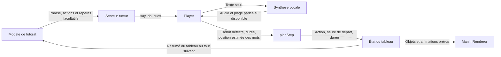

# Synchronisation entre la voix et le tableau — le cas des deux « cinq »

Le code synchronise le **départ d’une animation avec une estimation** de la position d’un mot. Il ne reçoit pas l’heure à laquelle le mot est effectivement prononcé pendant la séance et ne mesure pas quand l’objet devient visible à l’écran. Quand le modèle omet les repères, le lecteur distribue les actions selon leur ordre et leur durée. La voix et le tableau peuvent donc commencer ensemble et se désaligner au milieu de la phrase.

Cette analyse utilise deux tours de la même séance du **22 octobre 2026**, exportés de la production Vercel. La demande est une explication de l’addition avec des ronds. Je n’ai pas établi qu’il s’agit du test que tu viens de faire. La trace contient les phrases, commandes et réponses archivées, les requêtes reconstruites et les états complets du tableau. Les temps calculés utilisent une voix simulée à `2 400 ms` par phrase. L’archive ne contient ni le son joué ni les instants d’affichage du navigateur. [Trace JSON du rejeu](trace-synchronisation-addition.json)

## Qui génère, qui décide et qui contrôle

| Fonction | Entrée | Sortie et rôle dans le contrôle |
| --- | --- | --- |
| **Modèle de tutorat** et `buildMessages()` | Demande, historique et résumé du tableau. La consigne demande un `{id}` après le mot qui désigne un objet. | Génère `say`, `do` et éventuellement des marques dans le texte. Le modèle choisit ce qu’il veut montrer. Il ne fournit aucun temps audio. |
| `parseLine()` → `extractCues()` et `inferCues()` | Exemple de texte brut `Et 5 {cinqRonds} autres ronds…` et liste de commandes. | Retire les marques du texte à lire, garde une fraction de caractères par identifiant et essaie d’en déduire d’autres à partir des noms, libellés ou types. L’inférence ne sait pas que le premier `5` désigne cinq ronds et le deuxième le chiffre des unités. Une même marque `{id}` répétée conserve sa première occurrence. |
| `POST /api/voice` → `synthesizeSpeech()` | Texte nettoyé, sans repères. | Renvoie un fichier audio. Si le format le permet, l’en-tête `X-Speech-Span` indique le début et la fin de la partie parlée, sans fournir d’horodatage par mot. |
| `CloudSpeaker.prepare()` et `speak()` | La même phrase. | Obtient la durée du clip ou une estimation. En lecture cloud, le démarrage normal est signalé par `audio.onplaying`. En synthèse navigateur, c’est `utterance.onstart`. `Player.playStep()` attend le signal si disponible, avec une limite de `4 000 ms`. Le signal concerne le départ de l’audio, pas le mot « cinq ». |
| `retimeCues()` → `cueOffsetsMs()` | Phrase, fractions des repères, durée du clip, plage parlée si disponible. | Estime le temps écoulé avant chaque repère avec le poids des syllabes, des nombres et des pauses. Le calcul se répartit sur la plage parlée, ou sur toute la durée à défaut. Il ne lit pas les mots dans l’audio. |
| `planStep()` | Actions et repères recalés. | Calcule les départs et durées. Avec un repère, le départ est placé **150 ms avant** l’instant estimé, avec un minimum de `0`. Sans repère, les actions s’enchaînent selon leurs durées. `finish()` décale deux actions successives qui partagent le même identifiant de commande afin qu’elles ne se recouvrent pas. |
| `applyAction()` → `ManimRenderer.sync()` | Une action et son heure absolue prévue, puis le nouvel état complet du tableau. | Applique la commande au graphe, puis le renderer le compare à la scène et met les animations en file. Si un départ prévu est passé, le renderer le ramène à un départ immédiat lorsqu’il traite le lot. Le lecteur attend la fin de la voix et un délai calculé pour le dessin. Il n’attend pas une confirmation que le dernier objet a été effectivement rendu. |

Le contrôle est donc réparti. Le serveur contrôle la forme des étapes et leur conformité aux règles du tuteur. `planStep()` contrôle l’horaire prévu. `ManimRenderer` exécute les animations. Aucune de ces fonctions ne vérifie en direct que le bon objet devient visible au bon mot. Le diagnostic `GET /api/diagnostic?sync=1` synthétise et transcrit des phrases de démonstration qui ont déjà des repères. Il compare des temps estimés et transcrits, sans observer le rendu ni couvrir les phrases dépourvues de repère. [Consigne](../src/server/tutor/prompt.ts) · [Repères](../src/domain/tutor/cues.ts) · [Lecteur](../src/engine/player.ts) · [Planificateur](../src/domain/timeline/plan.ts) · [Renderer](../src/ui/board/manim/ManimRenderer.ts) · [Diagnostic](../src/server/ai/syncMeasure.ts)

## Ce qui est déjà au tableau

| Moment | État logique du tableau | Ce que la représentation permet de viser |
| --- | --- | --- |
| L’addition est posée. | `eq` contient `27 + 15 = ?`. `col1` contient `27`. `col2` contient `+ 15`, en orange, à `[1, 2]`. | `col2` vise toute la ligne `+ 15`. Il n’y a pas de cible pour le chiffre `5` seul. |
| Avant « Et 5 autres ronds… » | Les trois textes et les sept ronds bleus `u1…u7`. Leurs centres vont de `[4, 3]` à `[10, 3]`. | Sept objets séparés. Aucun groupe nommé pour les sept unités à ce moment. |
| Après l’étape des cinq ronds | Les cinq ronds orange `v1…v5` sont ajoutés. Centres de `[4, 2]` à `[8, 2]`, rayon `0.3` chacun. Le tableau possède alors quinze objets, dont douze ronds. | Chaque rond a son propre identifiant. Le lot orange n’a pas d’identifiant de groupe, ni de lien explicite avec le chiffre des unités de `15`. |
| Après la réponse `12` | Le tour suivant crée `g12` avec les douze ronds, `g10` avec `u1…u7` et `v1…v3`, et `g2` avec `v4` et `v5`. | Nesa peut déplacer et mettre en évidence un groupe. Les groupes référencent des ronds existants. |
| Au dernier QCM archivé | `g10` a été déplacé de `[-4, -2]`, `td` affiche `1 dizaine = 10 unités`, et `t2` affiche `2 unités`. La trace contient 17 nœuds et 3 groupes. | La dizaine peut être ciblée par `g10`. L’écriture initiale `+ 15` reste un seul objet. Aucun résultat final `42` n’a encore été écrit au point où s’arrête cet extrait. |

Le second appel au tuteur envoie `picked: "12"`, `correct: true`, `method: "answer-key"` et les quinze entrées que `summarizeBoard()` produit à ce moment. Le tableau local est plus riche que ce résumé. Par exemple, la scène stocke le type, le centre, la couleur et l’heure de départ de chaque rond. Le résumé transmet un identifiant, un type et une description courte. Le contexte envoie jusqu’à 40 entrées avec un tableau simple, ou une sélection par zone. Il ne transmet ni le temps réellement affiché, ni une relation comme « ces cinq ronds représentent le chiffre des unités de `15` ». [État et résumé du tableau](../src/domain/board/state.ts) · [Construction du contexte](../src/engine/player.ts)

## Pourquoi les cinq ronds arrivent en décalé

Dans l’étape enregistrée, `say` vaut « Et 5 autres ronds en dessous pour le 5 de 15. », `do` contient cinq commandes `circle` et `cues` est absent. `inferCues()` appliqué à la phrase et à ces commandes renvoie `{}`. `planStep()` ne reçoit donc aucune information indiquant à quel « cinq » associer les ronds.

| Rond | Début prévu depuis le départ de la phrase | Fin du créneau prévu par `planStep()` |
| --- | ---: | ---: |
| `v1` | `0 ms` | `1 200 ms` |
| `v2` | `720 ms` | `1 920 ms` |
| `v3` | `1 440 ms` | `2 640 ms` |
| `v4` | `2 160 ms` | `3 360 ms` |
| `v5` | `2 880 ms` | `4 080 ms` |

Dans ce rejeu à `2 400 ms`, le dernier cercle commence **480 ms après la fin simulée de la phrase**. Le créneau de `1 200 ms` est celui réservé par le planificateur. Pour un cercle sans étiquette, le renderer utilise `85 %` de ce créneau pour `Create`, soit `1 020 ms`. Ces deux chiffres décrivent deux couches différentes. Ils ne donnent pas l’heure à laquelle l’élève a effectivement vu le cinquième rond.

Le tableau local reçoit les nœuds avec leurs dates de révélation. Un nœud peut donc exister dans l’état avant son animation. Le lecteur sait réutiliser un objet déjà dessiné. Si une phrase porte un repère qui vise un nœud ou un groupe visible dans le tableau actif, et qu’aucune commande de l’étape ne vise déjà cette cible, `playStep()` ajoute un `highlight`. `{col2}` ferait ressortir `+ 15` en entier. Pointer le `5` seul suppose de créer une cible plus fine. De même, une courbe déjà présente peut être remise en évidence par son identifiant sans être retracée.

Pour isoler le problème des occurrences, j’ai simulé la même phrase avec deux identifiants distincts, `{cinqRonds}` après le premier `5` et `{col2}` après le second. Avec la même durée de `2 400 ms`, les instants estimés sont `400 ms` et `2 000 ms`. Le planificateur demande les mises en évidence à `250 ms` et `1 850 ms`. C’est une expérience de planification. `cinqRonds` n’existe pas comme groupe dans l’étape archivée et `col2` vise toujours la ligne entière.

## Plan d’action

1. **Mesurer le décalage de bout en bout sur cette phrase.** Rejouer les événements de Vercel dans un navigateur avec l’audio effectivement utilisé. Relever le début et la fin de chaque « cinq » dans cet audio, l’heure prévue de l’action, son démarrage côté renderer et le premier affichage visible. Distinguer le début du tracé du moment où les cinq ronds sont tous dénombrables. Faire la même mesure avec la voix de secours. Le diagnostic existant fournit une partie de la mesure audio, à compléter par le rendu.
2. **Rendre les deux cibles explicites dans le tableau.** Donner un identifiant au groupe des cinq ronds, un autre au chiffre des unités de `15`, et représenter leur relation. Commencer avec des objets existants et une cible de texte dédiée. Si la décomposition des nombres devient fréquente, étendre le modèle avec des fragments adressables, par exemple `col2.units`, et un lien `represents` vers le groupe. Donner au tuteur un résumé structuré de ces relations. Garder les détails de rendu dans un inspecteur de séance, accessible par étape, avec le tableau avant la commande, les changements et le tableau après.
3. **Définir ce que chaque mot doit déclencher.** Si la phrase dit « cinq ronds », choisir une apparition groupée ou une mise en évidence collective. Si elle compte « un, deux, trois, quatre, cinq », viser un rond par occurrence. Quand elle parle du « cinq de quinze », cibler le chiffre déjà présent. Vérifier que la cible existe au moment du geste et que chaque occurrence désignée a une action. Aujourd’hui, un repère par identifiant ne suffit pas pour rejouer plusieurs gestes sur le même objet dans une phrase.
4. **Faire dépendre le minutage de l’audio réellement joué.** Comparer les repères estimés à des horodatages de mots obtenus sur le clip lui-même. Si cette mesure est disponible de manière fiable avec le chemin vocal retenu, piloter les repères à partir du temps de lecture de l’audio. Conserver le mode estimé pour le secours. Rendre visibles les cas où il est utilisé. Vérifier aussi que la file de rendu et la reprise après interruption ne reportent pas ou ne rejouent pas un geste de manière inattendue.
5. **Fixer un test d’acceptation observable.** Pour cette phrase, le premier « cinq » doit désigner le lot orange et le second le chiffre des unités. Fixer un seuil d’écart pour le premier affichage, par exemple `±200 ms` comme cible initiale à valider, et préciser s’il se mesure au début ou à la fin du mot. Capturer le résultat sur ordinateur et téléphone. Ajouter les cas sans repère, avec repère répété, sur objet déjà visible et après interruption.

> Demande de travail. Rejouer la séance d’addition du 22 octobre avec audio et rendu mesurés. Montrer l’état du tableau à chaque étape. Rendre le groupe orange et le chiffre des unités adressables séparément, puis vérifier que les deux « cinq » déclenchent chacun le bon geste au bon moment. Fournir la comparaison avant et après avec les écarts mesurés.
