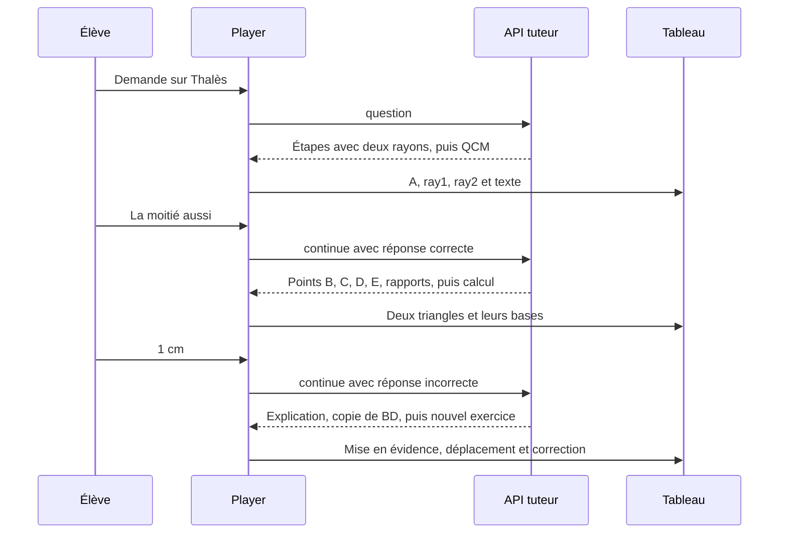

# Une séance de Thalès, de la question au tableau

Le 27 octobre 2026, une personne a demandé à Nesa « C'est quoi le theoreme de thales. » Au premier tour, Nesa a tracé deux rayons et a posé une question sur quatre points qu’elle n’avait pas encore dessinés. Au deuxième tour, la personne a répondu correctement au premier QCM, puis a répondu `1 cm` à un calcul dont le résultat était `9 cm`. Au troisième tour, Nesa a repris l’erreur, a animé une copie d’un segment et a proposé un nouvel exercice. L’enregistrement s’arrête sur ce dernier QCM.

Les trois tours proviennent d’un export du magasin privé de production Vercel. Le rejeu local utilise les événements enregistrés et les deux choix enregistrés. Il exécute le lecteur, le décodeur HTTP, la planification et les commandes de tableau du code actuel. La voix est simulée à `2400 ms` par phrase. Les durées de dessin ci-dessous viennent du rejeu. Les latences serveur viennent de l’archive. La trace contient les corps reconstruits et les résultats, sans identifiant de navigation ni référence d’inscription. [Trace JSON anonymisée](trace-seance-vercel-thales.json)



## Ce que la personne voit au fil des tours

| Tour | Requête envoyée | Ce qui arrive au tableau | Question et réponse observées |
| --- | --- | --- | --- |
| 1 | `question` avec « C'est quoi le theoreme de thales. » | `A` à `[0, 3]`, `ray1` vers `[5, 0.2]`, `ray2` vers `[5, 5.8]`, et `t1` sur les deux sécantes et les deux parallèles. | « Si AB vaut la moitié de AC, que vaut AD par rapport à AE ? » La personne choisit « La moitié aussi ». |
| 2 | `continue` avec `picked: "La moitié aussi"`, `correct: true` et le tableau du tour 1. | Ajoute `B`, `D`, `BD`, puis `C`, `E`, `CE`, les triangles et les rapports. Les étiquettes des bases indiquent `2,8` et `5,6`. | Nesa donne `AB = 2`, `AC = 6` et `BD = 3`, puis demande `CE`. La personne choisit `1 cm`. |
| 3 | `continue` avec `picked: "1 cm"`, `correct: false` et le tableau du tour 2. | Fait ressortir `CE`, copie `BD` sous l’identifiant `BDc`, montre `6 ÷ 2 = 3`, puis transforme l’étiquette `CE = ?` en `9 cm`. | « AB = 3, AC = 12 et BD = 5. Que vaut CE ? » La clé du QCM est `20 cm`. L’archive ne contient pas de réponse à ce QCM. |

## Les fonctions et leurs entrées et sorties

| Fonction et rôle | Entrée dans cette séance | Sortie ou effet |
| --- | --- | --- |
| `Player.ask(question)` démarre une séance. | `"C'est quoi le theoreme de thales."` | `reset()` vide le contexte pédagogique et le tableau. Le lecteur passe à `thinking` et ouvre un segment avec `{ mode: "question", question: … }`. |
| `openSegment()` prépare la file du tour. | Le mode `question` et la requête initiale. | Crée un segment avec une file vide, un curseur à `0` et un signal d’annulation. Lance `consume()` et la boucle de lecture. |
| `createHttpSource().open()` ouvre et décode le flux. | La requête et le signal. Dans le rejeu, `fetch` reçoit le corps normal et renvoie les événements d’archive. | Sérialise le corps pour `POST /api/tutor`. `readLines()` extrait les lignes, puis `StreamEvent.safeParse()` valide chaque événement. Le premier flux produit `source`, `lesson`, quatre `step`, puis `await`. |
| `consume()` met les étapes en attente et traite les signaux. | Événements du flux, dont le titre « Le théorème de Thalès » et les quatre étapes. | Met à jour le titre, ajoute les `step` à la file et marque le tour `awaiting` quand il lit `await`. |
| `playStep()` orchestre une étape. | Une phrase, ses commandes `do`, ses repères `cues`, le tableau courant. | Lance la voix, planifie les actions, applique les commandes, met à jour le sous-titre et passe à `checking` quand l’étape porte un QCM. |
| `retimeCues()` estime où tombent les repères dans la phrase. | Sur l’étape qui introduit `B` et `D`, repères reçus `B: 0.4210526`, `D: 0.8315789`, avec `2400 ms` de parole simulée. | Repères recalés `B: 0.51625`, `D: 0.8708333`. |
| `planStep()` fixe le début et la durée de chaque tracé. | Les commandes `point B`, `point D`, `segment BD` et les repères recalés. | `B` démarre à `1089 ms`, `D` à `1940 ms` et `BD` à `2210 ms` dans l’étape. Durées respectives de `450`, `450` et `650 ms`. La dernière action se termine à `2860 ms`. |
| `applyAction()` appelle la commande du registre. | Pour `BD`, `{ type: "segment", id: "BD", from: "B", to: "D" }` et `{ start: 8219, duration: 650 }`. | `segmentCommand.apply()` résout les noms en coordonnées et ajoute `BD`, de `[2.5, 1.6]` à `[2.5, 4.4]`. Le tableau conserve les points et les rayons. |
| `ManimBoard` appelle `ManimRenderer.sync()`. | Le nouvel état du tableau et l’heure du navigateur. | Le renderer construit les formes et programme leurs animations à partir des nœuds. Cette étape est lue dans le code. Les pixels du canvas et la synchronisation audio n’ont pas été mesurés dans le rejeu. |
| `Player.answer(index)` transmet le choix à `assessAnswer()`. | `answer(0)` au premier QCM, puis `answer(1)` au deuxième. | Le lecteur compare chaque index à la clé `0`. Résultats `correct: true` puis `correct: false`, tous deux avec `method: "answer-key"`. |
| `recordObservation()` conserve ce que la réponse établit. | Une réponse à choix guidée, avec le verdict. Pour `1 cm`, le QCM associe l’hypothèse « a divisé 3 par le rapport 3 au lieu de multiplier ». | Ajoute l’observation à l’historique. L’hypothèse provient du distracteur choisi. Le raisonnement de la personne n’a pas été saisi. |
| `answered()` et `tryContinue()` ouvrent le tour suivant. | La réponse, le signal `await`, le flux fermé et le tableau déjà construit. | `buildContext()` et `summarizeBoard()` condensent le tableau et l’historique. `tryContinue()` envoie `mode: "continue"` avec la question initiale, le contexte et la réponse. Le tableau reste en place. |

Les liens vers le code permettent de retrouver les fonctions du lecteur, de transport, de synchronisation, de construction et de rendu. [Lecteur](../src/engine/player.ts) · [Transport NDJSON](../src/services/tutor/httpSource.ts) · [Synchronisation](../src/domain/timeline/plan.ts) · [Commandes de figures](../src/domain/scene/commands/figure.ts) · [Renderer](../src/ui/board/manim/ManimRenderer.ts)

### Zoom sur le geste après l’erreur

La phrase « Regarde : une copie de BD glisse à côté de CE, et elle est bien plus courte » transporte trois actions. Le lecteur prévoit l’effacement de `tb` et l’apparition de `tbd` dès le début de l’étape. Le départ de la copie arrive `823 ms` plus tard et le déplacement dure `900 ms`.

```json
{ "type": "copy", "target": "BD", "id": "BDc", "near": "CE", "side": "left" }
```

`copyCommand.apply()` trouve `BD` dans le tableau, calcule une destination relative à `CE`, crée `BDc` et appelle `moveNodes()`. Le nœud garde les extrémités locales de `BD`. Son déplacement final vaut `[2.8065625, 4.5065625]` dans le repère interne du tableau. Le mouvement enregistré dans le nœud va de `[0, 0]` à cet offset, avec `start: 23724` et `duration: 900` dans l’horloge simulée. `ManimRenderer.syncNode()` consomme ensuite ce mouvement dans le navigateur pour faire glisser la copie. Plus tard, `transformCommand.apply()` change le texte `CE = ?` en `9 cm` sur le même objet `tce`. [Commande de copie et de transformation](../src/domain/scene/commands/motion.ts) · [État du tableau](../src/domain/board/state.ts)

### Ce qui se passe côté serveur

La route `POST /api/tutor` contrôle l’accès et le quota, puis valide la requête avec `TutorRequestSchema`. `tutorEvents()` orchestre le tour. `decideTeaching()` choisit la stratégie, `buildMessages()` produit les messages `system` et `user`, puis le fournisseur génère le texte. Le scanner et le parseur transforment le texte en événements. Le contrôleur peut refuser une étape et demander une réparation avant sa transmission. La route diffuse les événements validés en NDJSON et l’enregistreur conserve le tour. L’export fournit les événements sortants et les latences, tandis que les messages exacts du fournisseur et le contexte HTTP complet sont indisponibles pour cette séance. [Route API](../src/app/api/tutor/route.ts) · [Service tuteur](../src/server/tutor/service.ts)

J’ai exécuté `decideTeaching()` et `buildMessages()` dans le code actuel sur les requêtes reconstruites. Ces sorties décrivent le code d’aujourd’hui, avec les entrées du rejeu. Elles ne sont pas des décisions historiques extraites de Vercel.

| Entrée | Décision actuelle calculée | Messages construits |
| --- | --- | --- |
| Question initiale | `explain-and-model`, stratégie `worked-example`, `requireCheck: true` | `system`, `user` |
| Réponse « La moitié aussi » correcte | `guided-practice`, stratégie `guided-step`, `requireCheck: true` | `system`, `user` |
| Réponse « 1 cm » incorrecte | `remediate`, stratégie `decompose`, étape `hint`, une difficulté consécutive | `system`, `user` |

## Points faibles que le cas met en évidence

| Constat | Ce que montre la trace | Comportement à vérifier ou à améliorer |
| --- | --- | --- |
| Premier QCM en avance sur le dessin | Le QCM mentionne `B`, `C`, `D` et `E`. À cet instant, les objets disponibles sont `A`, `ray1`, `ray2` et `t1`. | Dessiner et nommer les quatre points et les deux parallèles avant de poser une question qui s’y réfère. |
| Le dessin et le calcul utilisent des rapports différents | Le dessin initial donne `BD = 2,8` et `CE = 5,6`, soit un facteur `2`. Le calcul suivant annonce `AB = 2`, `AC = 6` et `BD = 3`, soit un facteur `3`. La correction remplace les étiquettes, tandis que les coordonnées des bases restent les mêmes. | Afficher un nouveau schéma cohérent avec les valeurs de l’exercice, ou annoncer explicitement que la figure sert seulement à comparer les longueurs et ne représente pas l’échelle du calcul. |
| La copie s’écarte de la destination annoncée | La commande demande une copie à gauche de `CE`. Dans le rejeu, son abscisse finale vaut `2.5 + 2.8065625 = 5.3065625`, alors que `CE` est à `x = 5`. La copie se retrouve aussi plus haut. | Revoir le placement de `near` avec `side: "left"` et contrôler dans le navigateur que le geste permet de comparer les deux segments d’un coup d’œil. |
| Une action arrive après la disparition de sa cible | L’étape de vérification demande `dim` sur `BDc`. Le rejeu avait déjà effacé puis retiré ce nœud. La commande ne trouve plus d’objet à estomper. | Faire correspondre l’ordre des commandes à la durée de vie de la copie et détecter les cibles absentes avant transmission. |
| Le temps avant la première étape augmente | Mesures historiques des trois tours `2,277 s`, `15,327 s`, puis `37,802 s`. | Rechercher où se passe l’attente avec des mesures séparées pour l’arrivée du premier fragment du modèle, la première étape validée et l’envoi au lecteur. L’archive ne permet pas d’isoler la cause. |

## Demande d’amélioration

> Rejoue cette séance de Thalès et corrige les écarts observés entre les paroles, le dessin et le QCM. Avant de poser une question, vérifie que les points et segments nommés sont visibles. Quand l’exercice change les longueurs, garde le schéma cohérent avec les nouvelles valeurs ou annonce clairement son caractère indicatif. Après `1 cm`, conserve l’explication sur le sens du rapport, mais fais glisser la copie de `BD` à un endroit où l’élève peut la comparer à `CE`. Vérifie aussi qu’aucune commande ne vise la copie après son effacement. Pour chaque correction, montre le comportement avant et après, avec la requête, les actions, l’état du tableau et le rendu dans le navigateur.
